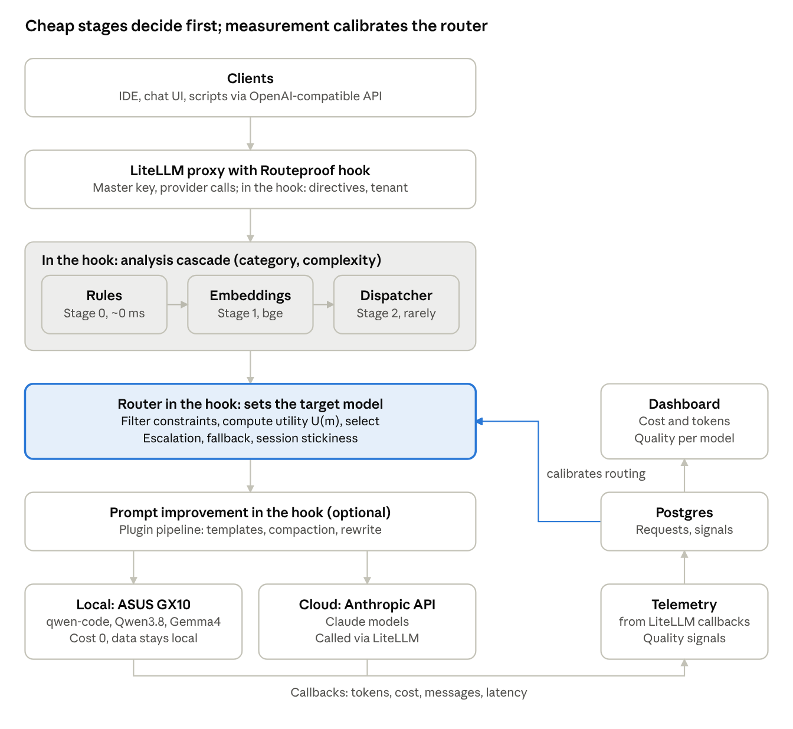
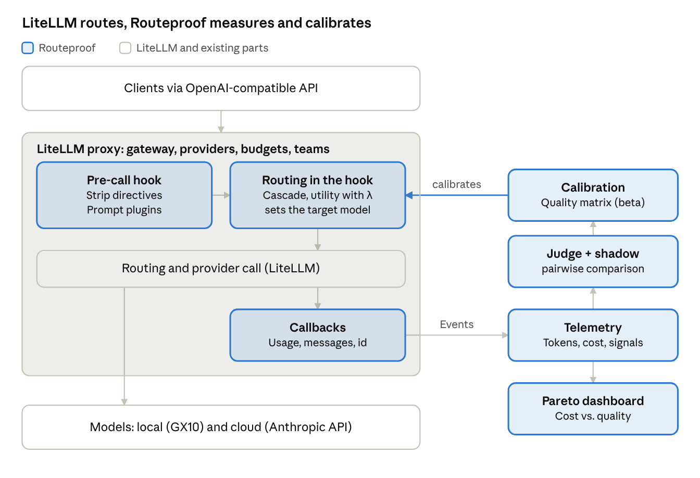
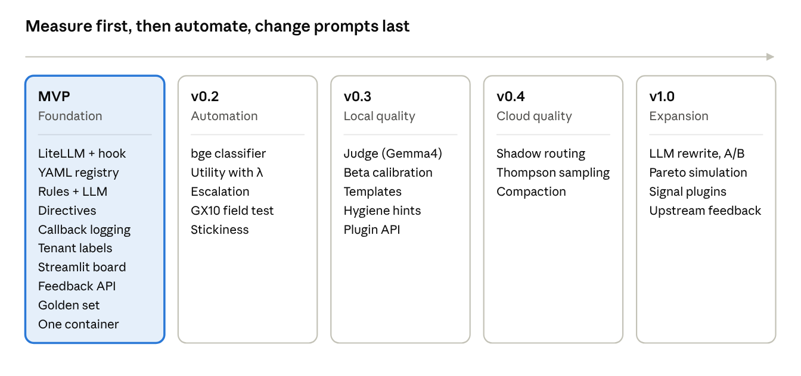

# Routeproof – Route optimizer for LiteLLM

> **Status:** concept, as of 16 Oct 2026. A spike against LiteLLM 1.105.1 has validated the approach; there is no usable code yet.

## Goal and principles

Routeproof is an open-source plugin for the LiteLLM proxy (MIT license). It sends every prompt to the cheapest model that solves it well enough, and it measures whether that routing decision was right. LiteLLM stays the gateway and provides the OpenAI-compatible API, provider calls, keys and budgets. Routeproof hooks into the proxy, analyses and categorizes each prompt, picks the model and calibrates its choices from measured quality. The goal is the best cost/quality trade-off.

- **A plugin, not a proxy:** Routeproof is installed into a LiteLLM proxy and adds no gateway of its own. Clients keep talking to the proxy and request the model alias `routeproof`.
- **Cheap decisions:** Routing must cost only a fraction of what it saves. A cascade decides, instead of sending every prompt through a dispatcher LLM.
- **Measure, don't guess:** Every decision is logged and evaluated. Routing learns from this data.
- **Everything configurable:** Models, categories, thresholds, directives and policies live in YAML, secrets in `.env`.
- **Transparent:** Every response carries headers with request id, chosen model and any warnings.
- **From solo developer to team:** Only a LiteLLM master key and no user management for now, but statistics per tenant and cost center.

## Architecture

Routeproof runs as a hook inside the LiteLLM proxy (path B, decided on 16 Oct 2026). LiteLLM handles the gateway, master key and provider calls. Before routing, the proxy calls the Routeproof pre-call hook: directives, the analysis cascade, the router and prompt improvement set the target model there. LiteLLM callbacks deliver tokens, cost and messages to telemetry, from which Routeproof calibrates its quality matrix.



The cascade only passes a prompt to the next stage when the previous one is not confident enough. The hook only acts on requests to the alias `routeproof`; clients can still call a specific model directly.

## Prompt analysis

For every request the analysis returns a category, a complexity (1 to 5), a confidence and flags. It runs as a cascade: each stage decides only when it is confident enough.

**Categories (configurable):** `coding`, `debugging`, `architecture`, `math/reasoning`, `creative_writing`, `summarization`, `extraction`, `translation`, `chat`, `agentic/tool_use`, `vision`.

**Complexity features:**

| Feature | Example signal |
| --- | --- |
| Context size | tokens in the prompt, number of attached files |
| Structural depth | number of subtasks and conditions |
| Domain markers | “race condition”, “refactoring across modules” vs. “regex for an email address” |
| Code signals | language, lines of code, stack traces, multi-file diffs |
| Tool use | tools or function calls in the request |
| Conversation history | long conversation, earlier failures, repetitions |
| Soft hints | “quick”, “thorough”, “production-ready” (see directives) |

**The cascade:**

1. **Stage 0, rules** (about 0 ms): decide clear cases directly. An image goes to a vision model, more than 100k tokens to a long-context model, directives force a model.
2. **Stage 1, embedding classifier** (about 10 ms, local): bge embeddings with kNN or logistic regression on labelled examples.
3. **Stage 2, dispatcher LLM** (only when confidence is below e.g. 0.7): a small local model returns structured JSON with `category`, `complexity`, `confidence`, `reasoning` and `needs_tools`.

The dispatcher LLM's answers double as training data for stage 1, so stage 2 is needed less and less over time.

**Conversation detection:** The OpenAI API is stateless; every request carries the full history. Routeproof detects conversations on its own: the hash of `messages[:-1]` matches the hash of the previous request plus its answer. Clients do not have to send anything extra.

## Directives in the prompt

Directives in the prompt let users override the automatic routing per request. Hard directives are detected reliably and stripped from the prompt before it is forwarded. Soft hints only feed into classification as a feature and stay in the prompt.

| Directive | Effect |
| --- | --- |
| `@model:<id>` | forces a specific model |
| `@premium` / `@standard` / `@local` | forces a tier (aliases are configurable) |
| `@min:<tier>` / `@max:<tier>` | lower or upper bound; the automatic routing decides in between |
| `@cheap` / `@best` | shifts λ for this request |
| `@cat:coding` | sets the category, classification is skipped |
| `@private` | local models only, no shadow routing, no prompt storage |
| `@noshadow` | exclude this request from shadow routing |
| `@improve` | enable prompt improvement for this request |
| `@explain` | append the routing rationale to the response |
| `@sticky` / `@reset` | keep or release the model choice for the conversation |

Directives can be combined, e.g. `@cat:coding @max:standard @explain`.

```yaml
directives:
  prefix: "@"
  strip_from_prompt: true
  position: leading          # only at the start of the message
  tiers:
    local:    [qwen-code, qwen3.8, gemma4]
    standard: [claude-sonnet]
    premium:  [claude-opus]
  aliases:
    "@code":  "@cat:coding"
    "@deep":  "@best @min:standard"
    "@quick": "@cheap @max:local"
  soft_hints:
    - {pattern: "(?i)\\b(quick|short|schnell|kurz)\\b", complexity: -1}
    - {pattern: "(?i)\\b(thorough|detailed|production)\\b", complexity: +1}
    - {pattern: "(?i)\\b(confidential|internal|vertraulich)\\b", flag: private}
```

**Where directives may appear:**

- Start of the last user message: applies to this request only. Earlier messages in the history do not count.
- System prompt: applies to the whole conversation, e.g. as a project default.
- Header `X-Route`: same syntax, for scripts.

Directives are only detected at the start of a message, so a Python decorator such as `@property` in pasted code is not mistaken for one. Escape: `\@`.

**Precedence in conflicts:**

1. Policies (privacy, budget block), cannot be overridden
2. Directives in the prompt or header
3. Tenant defaults
4. Automatic routing

Directives may narrow routing but never weaken a policy. For a tenant with `privacy: local`, `@premium` is ignored and the response carries `X-Routeproof-Warning: directive_overridden_by_policy`. If a forced model is unavailable, Routeproof falls back to a model of the same tier (optionally `on_unavailable: fail`).

**Directives as a quality signal:** If a user resends the same prompt with `@premium` after an automatic local choice, that is a strong negative signal for the local model. Forced requests are not counted when evaluating the automatic routing.

## Model registry and cost model

Models and their endpoints are defined in LiteLLM's `config.yaml` as usual. Routeproof's own `routeproof.yaml` references those model names and adds what routing needs: tier, privacy, capabilities and a quality prior. The dispatcher LLM is an entry in the same registry.

Cost is kept simple: LiteLLM's `model_info` holds a fixed price per input and output token, and LiteLLM computes the cost of every call from the `usage` block. Routeproof reads that cost from the callback. Local models have a price of 0, or a notional price so that their load shows up in the dashboard.

```yaml
# LiteLLM config.yaml (excerpt)
model_list:
  - model_name: qwen-code
    litellm_params: {model: openai/qwen-code, api_base: http://gx10:8000/v1, api_key: none}
    model_info: {input_cost_per_token: 0.0, output_cost_per_token: 0.0}
  - model_name: claude-opus
    litellm_params: {model: anthropic/<model-id>, api_key: os.environ/ANTHROPIC_API_KEY}
    model_info: {input_cost_per_token: 0.000015, output_cost_per_token: 0.000075}  # placeholder

litellm_settings:
  callbacks: routeproof.hooks.proxy_handler_instance
```

```yaml
# routeproof.yaml
dispatcher:
  model: qwen3.8-small
  confidence_threshold: 0.7
  cost_weight_lambda: 0.4      # 0 = quality only, 1 = cost only

models:
  qwen-code:
    tier: local
    privacy: local
    context_window: 32768
    capabilities: [coding, debugging, chat]
    quality:                   # prior, calibrated by feedback
      coding:    {1: 0.95, 2: 0.9, 3: 0.75, 4: 0.5, 5: 0.3}
      debugging: {1: 0.9,  2: 0.8, 3: 0.6,  4: 0.4, 5: 0.2}
  claude-opus:
    tier: premium
    privacy: cloud
    context_window: 200000
    capabilities: [coding, debugging, architecture, reasoning, agentic]
    quality:
      coding: {1: 0.98, 2: 0.98, 3: 0.96, 4: 0.93, 5: 0.88}

policies:
  - name: sensitive-data-stays-local
    when: {flags: [private]}
    restrict_to: {privacy: local}
```

Budgets per key, team and model are left to LiteLLM, which already enforces them.

Note on “Claude Code”: Claude Code is a CLI agent, not a REST endpoint. The registry lists the Anthropic API with a Claude model, which LiteLLM calls like any other provider.

## Routing logic

The router first filters by hard constraints and then picks the model with the highest utility. λ is the main control on the cost/quality curve and can be set per tenant or per request.

1. **Filter constraints:** Drop models whose context window is too small, that lack a capability, violate a policy, failed a health check or fall outside directive bounds (`@min`/`@max`).
2. **Compute utility** for every remaining model m:

```latex
U(m) = P(\text{good enough} \mid m, \text{category}, \text{complexity}) - \lambda \cdot \text{cost}_{norm}(m) - \mu \cdot \text{latency}_{norm}(m)
```

3. **Select:** the model with the highest utility, using Thompson sampling (see quality measurement) instead of the mean, so uncertain cells are explored now and then.

**Escalation (cascade routing):** For requests in the grey zone, the cheap model is tried first. Escalation happens on errors or timeouts, invalid JSON or code (syntax check), `finish_reason=length` or a low self-check score.

**Session stickiness:** Agentic conversations with many tool calls must not switch models per turn, or context, prompt caching and consistency are lost. Routing is therefore decided per conversation: upgrades are allowed, downgrades within a conversation are not. `@sticky` and `@reset` control this explicitly.

**Fallbacks:** If the chosen model is unavailable, LiteLLM's fallbacks send the request to the next model; Routeproof provides the order from its utility ranking. Streamed responses are only rerouted before the first token.

## Tenants and cost centers

For now, tenants are only labels for statistics, without user management (the proxy only requires a master key). Routeproof resolves them in this order:

1. Headers `X-Tenant` and `X-Cost-Center` (tested in the spike)
2. The `user` field of the OpenAI request (tested in the spike, logged as `end_user`)
3. LiteLLM virtual keys with team and alias, once Postgres is running
4. Fallback `default`

Using the API key itself as a label is not possible: the proxy requires a master key and validates every key.

Defaults and privacy can be set per tenant:

```yaml
tenants:
  default: {store_prompts: full, shadow: true,  lambda: 0.4}
  client-x: {store_prompts: hash, shadow: false, privacy: local}
```

`store_prompts` controls whether prompts are stored in plain text (`full`), only as a hash (`hash`) or not at all (`none`). The judge and shadow routing need plain text; all other statistics do not.

## Quality measurement and feedback loop

Routing rests on one number: P(good enough | model, category, complexity). Cost is measured exactly; quality is not measured by itself. Without measurement the quality values stay guesses, and the dashboard shows the savings but not whether they cost quality. Routeproof therefore measures the yes/no question “was the cheap model good enough”, not an absolute quality score.

### Signal levels

| Level | Signal | Cost | Reliability |
| --- | --- | --- | --- |
| 0 Passive | regenerate, error in follow-up, rephrasing, carrying on, technical defects, syntax check | free | medium, thin for single requests |
| 1 Explicit | `POST /routeproof/feedback` with request id, thumbs in the dashboard | free | high, but rare |
| 2 Judge | a local model rates a sample (5–10 %) | GPU time | good for complexity 1–3 |
| 3 Shadow | sample also sent to premium, pairwise comparison | real money, budgeted | high |
| 4 Golden set | 30–100 own prompts with checkable results | one-off | high, for cold start |

**Level 0, passive signals:** Detected from API traffic alone via conversation detection. Regenerate = same history with the same last message shortly after. Error in follow-up = the next message contains a stack trace or “doesn't work”. Rephrasing = bge similarity to the previous message above 0.9. Technical defects = `finish_reason=length`, empty answer, refusal, invalid JSON or invalid tool calls. LiteLLM's adaptive router uses similar regex-based signals; Routeproof adds the levels below.

**Level 1, explicit feedback:** Every response carries the header `X-Routeproof-Id`. Feedback goes to `POST /routeproof/feedback {"id": "...", "score": 1|-1, "comment": "..."}` or via thumbs in the request explorer.

**Level 2, LLM as judge:** A local model other than the one being rated (e.g. Gemma4) checks whether the answer is correct and complete. Limits: a judge only spots errors up to its own level, and models rate their own model family too favourably.

**Level 3, shadow routing:** The user gets the cheap model's answer. Asynchronously, the same prompt goes to the premium model, and the judge compares pairwise: “Is A at least as good as B?” Pairwise comparison works much better than absolute rating, even for weaker judges. The result directly answers whether premium would have been worth it.

```yaml
shadow:
  enabled: true
  sample_rate: 0.03       # 3 % of requests
  monthly_budget: 10      # shadow routing pauses after that
  focus: uncertain        # prefers complexity 3–4
```

**Level 4, golden set:** Typical prompts of your own, ideally with a reference answer or unit tests. They run when a model is added, after model updates and on demand.

### From signals to a number

Each cell (model × category × complexity) holds a beta distribution with a success count α and a failure count β. The prior from the config becomes pseudo-counts (0.75 with weight 10 gives α = 7.5, β = 2.5). Each signal adds its weight.

| Signal | Weight |
| --- | --- |
| explicit feedback | 3.0 |
| manual upgrade via directive | 3.0 |
| shadow comparison | 2.0 |
| technical error | 2.0 |
| absolute judge rating | 1.0 |
| regenerate, error in follow-up | 1.0 |
| carrying on | 0.3 |

```latex
P = \frac{\alpha}{\alpha + \beta}
```

**Example:** qwen-code, coding, complexity 3, prior 0.75. After 40 requests with 6 regenerates, 2 negative shadow comparisons and 25 cases of carrying on, α = 7.5 + 25 × 0.3 = 15.0 and β = 2.5 + 6 + 2 × 2 = 12.5. So P ≈ 0.55, clearly worse than assumed. Complexity-3 prompts then automatically go to premium more often.

- **Decay:** Old signals lose weight (e.g. a 30-day half-life), so model updates and changing prompts are reflected. LiteLLM's adaptive router has no decay and stops updating at 200 observations per cell.
- **Exploration:** Thompson sampling draws from the distribution instead of using the mean. The router therefore occasionally tries the cheap model in uncertain cells and notices when it has improved.

**Getting started:** The MVP has level 0, level 1 and a golden set of about 30 prompts. Then level 2 with a 5 % sample, then level 3 with a small budget. Tenants with `privacy: local` get no shadow routing to the cloud.

## Prompt improvement

Prompt improvement shifts the cost/quality curve directly: a better-phrased prompt can let a local model solve it, so premium is not needed. Local models benefit more from this than premium models. Because changing a prompt can damage intent, agents and code, there are four levels from safe to invasive. Each level is a plugin, and custom plugins can be added without touching the core.

| Level | What happens | Risk | Phase |
| --- | --- | --- | --- |
| 1 Templates | model-specific system prompt or format, user message unchanged | low | with quality measurement |
| 2 Compaction | remove duplicates, summarize old history; code and tool results stay | medium | after that |
| 3 LLM rewrite | a local model restructures the user message, opt-in only via `@improve` or config | high | last |
| 4 Advise | prompt hygiene hints in the dashboard, no change | none | with quality measurement |

**Guardrails for rewriting:**

- Code blocks, quotes, data and tool messages are masked and reinserted unchanged.
- Never for `agentic/tool_use`, never in an agent's system prompt.
- A check (bge similarity of original vs. rewrite) discards rewrites that drift too far.
- Original and rewrite are logged, and the response carries `X-Routeproof-Rewritten: true`.

**Compaction and caching:** Where the target model uses prompt caching, compaction can destroy the cache benefit. In that case the history stays stable.

### Plugin architecture

Prompt improvement is a pipeline of plugins, configured in YAML in a fixed order. The four levels above ship as built-in plugins. Guardrails, logging and A/B measurement are provided by the core, not by the plugin, so a plugin cannot bypass them.

**Interface:** Every plugin implements the abstract base class `PromptTransformer`.

```python
class PromptTransformer(ABC):
    """Base class for prompt improvement plugins."""

    name: str
    mode: Literal["transform", "advise"]   # advise = hints only, no change

    @abstractmethod
    def applies(self, ctx: RouteproofContext) -> bool:
        """Return True if the plugin should run for this request."""

    @abstractmethod
    async def transform(self, request: ChatRequest, ctx: RouteproofContext) -> TransformResult:
        """Return the changed request plus a short reason for the log."""
```

`RouteproofContext` provides category, complexity, target model, tenant and directives. Plugins run inside the pre-call hook after the routing decision, because templates and compaction depend on the target model.

**Configuration:**

```yaml
prompt_improvement:
  pipeline:
    - plugin: model_templates          # built in
    - plugin: context_compaction
      when: {tier: premium}
      config: {max_history_tokens: 8000}
    - plugin: llm_rewrite
      when: {directive: improve, category: [chat, summarization]}
      config: {model: gemma4, max_similarity_drop: 0.15}
    - plugin: my_company.glossary      # custom plugin
  timeout_ms: 1500                     # per plugin
  ab_test: {enabled: true, share: 0.5}
```

**Loading plugins:** via Python entry points (`routeproof.transformers`) for installed packages, or as files in a `plugins/` directory mounted into the container as a volume.

**What the core does around every plugin:**

1. Mask code blocks, tool messages and agent system prompts, and reinsert them unchanged after the plugin
2. Enforce the timeout; on error or timeout the original prompt is forwarded and the error is logged with the request id
3. Compare original and result for similarity and discard results that drift too far
4. Log the diff and reason, set `X-Routeproof-Rewritten`
5. Assign the A/B group and mark `improved` per plugin for the quality matrix

This lets the dashboard show the effect **per plugin**, and a plugin without measurable benefit can be switched off in the config. The same plugin mechanism is planned for classifiers and quality signals later.

**Measuring the effect:** Prompt improvement runs as an A/B test. The quality matrix gets an extra dimension `improved: true/false`. The key figure: how often does the local model solve an improved prompt that would have gone to premium without the improvement? Prompt improvement is not introduced before quality measurement is running.

## Dashboard

The dashboard's headline figure is the saving compared with “everything to premium”, together with the quality that saving cost. All views can be filtered by tenant, cost center and time range.

| Area | Content |
| --- | --- |
| Overview | cost today/this month, saving vs. premium, requests, local vs. cloud share, good-enough rate, escalation rate |
| Per model | input/output tokens, cost, requests, latency p50/p95, error rate, quality per category |
| Routing | heatmap category × complexity → model, confidence distribution, share of dispatcher LLM calls |
| Quality | good-enough rate per cell with confidence interval and sample count, “would premium have been worth it?”, trend per model, signal sources |
| Cost/quality | Pareto plot of cost vs. quality with the current operating point and a “what if λ = x” simulation |
| Directives | share of overridden requests, upgrade rate, cost caused by directives |
| Prompt improvement | A/B result, hygiene hints per tenant |
| Request explorer | a single decision with features, scores, directive, rationale, original and rewrite if any, thumbs feedback |

Technology: Streamlit for the MVP. LiteLLM's own UI and Prometheus metrics stay available alongside.

## Tech stack and hardware

Routeproof ships as a Python package inside the official LiteLLM proxy image, all in one Docker container. Local models run on an ASUS GX10; premium models come through the Anthropic API.

| Component | Choice | Reason |
| --- | --- | --- |
| Gateway, providers | LiteLLM proxy (`ghcr.io/berriai/litellm`, pinned version, v1.105.1 in the spike) | OpenAI API, streaming, fallbacks, budgets and master key already exist |
| Routing, directives, prompt improvement | Routeproof pre-call hook (`async_pre_call_hook`) | tested in the spike: sets `data["model"]` and changes messages |
| Telemetry | Routeproof callback (`async_log_success_event`) | delivers messages, response, tokens, cost and tenant |
| Classifier | sentence-transformers (bge) + scikit-learn | local, fast, retrainable |
| Judge and shadow worker | asyncio tasks, calls through the proxy | uses the same models and the same cost tracking |
| Storage | Postgres | LiteLLM state and Routeproof data; SQLite is not enough |
| Dashboard | Streamlit | quick to iterate |
| Deployment | one Docker container | image based on the LiteLLM image |
| Configuration | LiteLLM `config.yaml` + `routeproof.yaml`, secrets in `.env` |  |

**One container:** All parts run in one image based on the LiteLLM image. The LLMs themselves do not run in it; the proxy calls them through their endpoints (locally on the GX10, Claude through the Anthropic API).

| Process in the container | Task | Port |
| --- | --- | --- |
| LiteLLM proxy with Routeproof hook and callback | OpenAI-compatible API, routing, telemetry | 4000 |
| Dashboard (Streamlit) | statistics, request explorer, feedback | 8501 |
| Worker (asyncio tasks in the proxy process) | judge, shadow routing, calibration, retraining | – |
| Postgres (optionally in the container) | LiteLLM data, telemetry, quality matrix | 5432, internal only |

A lightweight process supervisor (e.g. supervisord) starts the proxy, the dashboard and, if needed, Postgres. For teams, Postgres runs externally and the container stays the same. The proxy only starts with `LITELLM_MASTER_KEY`; clients use this key or, later, virtual keys.

```yaml
# docker-compose.yml
services:
  routeproof:
    image: ghcr.io/routeproof/routeproof:latest   # FROM ghcr.io/berriai/litellm:<pinned version>
    ports: ["4000:4000", "8501:8501"]
    env_file: .env                    # LITELLM_MASTER_KEY, ANTHROPIC_API_KEY, DATABASE_URL
    volumes:
      - ./config:/routeproof/config   # LiteLLM config.yaml, routeproof.yaml
      - ./plugins:/routeproof/plugins # custom prompt improvement plugins
      - ./data:/routeproof/data       # Postgres data, golden set, classifier model
    restart: unless-stopped
```

The LiteLLM version is pinned because hooks and logging fields can change between versions. Every update first runs against the spike tests (echo backend, 4 routing cases).

**Roles on the GX10:** The 128 GB of unified memory let all models stay loaded at once. Memory bandwidth is limited, so MoE models run much faster than large dense models.

| Role | Model |
| --- | --- |
| Classifier (stage 1) | bge |
| Dispatcher LLM (stage 2) | smallest variant of Qwen3.8 or Gemma4 |
| Coding, simple to medium | qwen-code |
| General, chat, text | Qwen3.8 / Gemma4 |
| Judge | Gemma4 (a different model from the one being rated) |
| Coding, complex | Claude via the Anthropic API |

## Competitive landscape

Several open-source projects now offer content-based routing. Closest to this concept is LiteLLM's auto routing (beta): complexity tiers, Thompson sampling, session affinity and classifier plugins. Research as of 16 Oct 2026.

| Project | Type, license | Routing | Relevance |
| --- | --- | --- | --- |
| [LiteLLM auto routing](https://docs.litellm.ai/docs/proxy/auto_routing) | open-source gateway, MIT | tiers simple/medium/complex/reasoning via heuristic, LLM classifier, keyword rules or custom plugin; Thompson sampling, session affinity | largest overlap; Routeproof's host |
| [vLLM Semantic Router](https://github.com/vllm-project/semantic-router) | open source, Apache-2.0 | selects or combines models per request by quality, latency and cost; guardrails | very capable, built for Envoy and Kubernetes |
| [Plano](https://github.com/katanemo/archgw) (Katanemo) | open-source proxy on Envoy, Apache-2.0 | preference-based routing with a 4B routing model, OpenTelemetry | preferences rather than cost/quality |
| [RouteLLM](https://github.com/lm-sys/RouteLLM) (LMSYS) | framework with OpenAI server, Apache-2.0 | binary strong/weak, e.g. matrix factorization | research basis; little maintenance since 2024 according to third parties |
| [NadirClaw](https://dev.to/getnadir/nadirclaw-getting-started-in-5-minutes-ne9) | OpenAI-compatible proxy, MIT | embedding classifier (about 10 ms), verify-and-escalate, Docker with Ollama | very similar cascade, small project |
| [Semantic Router](https://github.com/aurelio-labs/semantic-router) (Aurelio Labs) | Python library, MIT | embedding routes from example utterances with a threshold | building block for stage 1 |
| [Bifrost](https://github.com/maximhq/bifrost) (Maxim) | gateway in Go with web UI, Apache-2.0 | fallbacks, load balancing, semantic cache, plugins | gateway alternative, no complexity routing in the README |
| [Portkey Gateway](https://github.com/Portkey-AI/gateway) | gateway, MIT | fallbacks, retries, load balancing, conditional routing, guardrails | no content-based routing in the open-source version |
| [OpenRouter auto router](https://openrouter.ai/docs/guides/routing/routers/auto-router) | SaaS | about 30 task types; ranks models by all users' spend share over the last 7 days; no surcharge | no self-hosted endpoints mentioned |
| [Not Diamond](https://www.notdiamond.ai/) | commercial | predicts the right model per input | pricing on request |

Martian, often named as a routing vendor, now describes itself on its [own website](https://withmartian.com/) as a research team with no visible routing product.

**Gaps this concept fills:** No project reviewed combines all four:

1. Quality measurement with shadow routing and a pairwise judge that keeps calibrating the quality matrix
2. A dashboard with a Pareto view of cost vs. quality, split by tenant
3. Directives in the prompt with policy precedence
4. Prompt improvement plugins with A/B measurement per plugin

**Consequence:** Routeproof builds on LiteLLM as a plugin instead of running its own gateway, and focuses on the four points above. Star counts and maintenance status come partly from third-party sources and should be checked before relying on them.

## Feature matrix

Routeproof differs mainly in quality measurement, the dashboard, directives and prompt improvement. Its gateway features come from LiteLLM, its host. Rating: **yes** · **partly** · **no** · **?** = not documented in the sources read. Bifrost, Portkey and Plano are left out because they document no content-based complexity routing.

### Basics

| Feature | Routeproof | LiteLLM | vLLM SR | Switchyard | NadirClaw | RouteLLM | OpenRouter |
| --- | --- | --- | --- | --- | --- | --- | --- |
| OpenAI-compatible API | yes (via LiteLLM) | yes | yes | yes (+ Anthropic) | yes | yes | yes |
| Local models | yes | yes | yes | ? | yes (Ollama) | yes | no |
| Any number of models | yes | yes (pools per tier) | yes | yes (pool) | partly | no (2 models) | yes (catalog) |
| Self-hosted, one container | yes | yes | partly (Envoy, K8s) | partly (Dockerfile) | yes | yes | no (SaaS) |
| License | MIT | MIT | Apache-2.0 | Apache-2.0 | MIT | Apache-2.0 | proprietary |

### Analysis and routing

| Feature | Routeproof | LiteLLM | vLLM SR | Switchyard | NadirClaw | RouteLLM | OpenRouter |
| --- | --- | --- | --- | --- | --- | --- | --- |
| Category detection | yes, configurable | partly (keyword rules, 7 request types) | yes | no | ? | no | yes (about 30 types) |
| Complexity rating | yes (1–5) | yes (4 tiers) | partly | partly (is the cheap model enough?) | yes | yes (strong/weak) | partly (cost\_tier) |
| Cascade rules → embeddings → LLM | yes | partly (heuristic or LLM) | ? | partly | partly (embeddings) | no | ? |
| Custom classifier plugins | yes | yes | ? | yes (on own data) | no | partly (trainable) | no |
| Cost/quality utility with λ | yes | yes (adaptive router weights) | partly (priorities) | partly | no | partly (threshold) | partly |
| Escalation on a poor answer | yes | partly (context window) | ? | yes | yes (verify-and-escalate) | no | partly (fallbacks) |
| Session stickiness | yes | yes (optional) | ? | ? | ? | no | ? |
| Directives in the prompt | yes | partly (keyword rules, min quality tier header) | ? | ? | ? | no | no |
| Policies (local only, budget) | yes | yes (budgets) | partly (PII) | ? | ? | no | partly (max\_price) |

### Measurement and dashboard

| Feature | Routeproof | LiteLLM | vLLM SR | Switchyard | NadirClaw | RouteLLM | OpenRouter |
| --- | --- | --- | --- | --- | --- | --- | --- |
| Token and cost logging per model | yes (via LiteLLM) | yes | ? | ? | ? | no | yes |
| Tenants, cost centers | yes (labels) | yes (teams, keys) | ? | ? | partly (paid tier) | no | partly |
| Learns from feedback | yes (beta with decay) | partly (adaptive router, regex signals, no decay) | ? | partly (execution signals) | partly (paid tier) | partly (offline) | partly (market data) |
| Shadow routing, judge | yes | no (not in the adaptive router) | ? | ? | ? | no | no |
| Pareto dashboard cost vs. quality | yes | ? | ? | ? | ? | no | no |

### Prompts and maturity

| Feature | Routeproof | LiteLLM | vLLM SR | Switchyard | NadirClaw | RouteLLM | OpenRouter |
| --- | --- | --- | --- | --- | --- | --- | --- |
| Prompt improvement plugins | yes | ? | ? | ? | ? | no | no |
| Guardrails, PII | via LiteLLM | yes | yes | ? | ? | no | ? |
| Maturity | concept, spike done | beta feature in an established project | active, about 6.2k stars | pre-1.0, about 3.4k stars | small, about 430 stars | about 5.6k stars, little maintenance | in production |

Sources: see the links in the competitive landscape section, plus [NVIDIA Switchyard](https://github.com/NVIDIA-NeMo/Switchyard). The LiteLLM column includes what the spike found in the source code of v1.105.1. The many question marks are items to check in a closer evaluation, not a statement that the feature is missing.

## Conclusion and repositioning

Another standalone router with its own gateway is hard to justify. A measurement and optimization layer on top of LiteLLM fills a gap in the market instead. Routeproof is therefore repositioned: LiteLLM routes, Routeproof measures whether the routing was right and calibrates it.

**Not a differentiator:** Core routing is standard. LiteLLM auto routing offers complexity tiers, classifier plugins, Thompson sampling, session affinity, budgets and teams. NadirClaw, vLLM Semantic Router and NVIDIA Switchyard cover similar principles. At the same time, a gateway of one's own is the hardest part to operate (streaming, tool calls, provider quirks).

| Differentiator | Strength | Reason |
| --- | --- | --- |
| Quality measurement with shadow routing and a pairwise judge | strong | Others route by estimate or by other users' behavior. Nobody measures whether the cheap model was good enough for your own prompts. |
| Pareto dashboard cost vs. quality | strong | Everyone shows cost; nobody shows what the saving cost in quality. |
| Prompt improvement plugins with A/B per plugin | medium | New, but risky and only useful once measurement is running. |
| Directives with policy precedence | weak | Quickly rebuilt with keyword rules or a pre-call hook. |
| Local-first, one container | weak | NadirClaw and LiteLLM offer this too. |

**Positioning:** “LiteLLM routes. Routeproof proves it.” Routeproof plugs into LiteLLM's extension points and stays one container (LiteLLM proxy and Routeproof in one image).



Calibration feeds measured quality back into routing inside the hook. That closes the loop of measuring, calibrating and routing.

**Advantages:** a much smaller MVP with no gateway or provider code of its own; building on an established project instead of competing with it; clear positioning.

**Risks:** LiteLLM hooks and logging fields can change between versions, so the version is pinned. LiteLLM could add quality measurement itself; the calibration logic could then be contributed upstream.

**Decision (16 Oct 2026):** The spike answered all four questions with yes. Routeproof takes path B: its own routing in the LiteLLM proxy's pre-call hook. Architecture, tech stack and roadmap have been updated accordingly.

## Spike results (LiteLLM 1.105.1)

The repositioning holds: through stable proxy hooks, Routeproof can pick the model, change prompts and capture all measurement data. At the same time, LiteLLM already contains an adaptive router with much of the planned quality logic. Routeproof's differentiation narrows to the judge, shadow routing, calibration with decay, the Pareto dashboard and prompt plugins.

Tested on 16 Oct 2026 locally (macOS, arm64) with an OpenAI-compatible echo backend instead of real models. The backend returns the model name and the messages it received, so routing and prompt changes can be verified.

| Question | Result | Finding |
| --- | --- | --- |
| 1 Pick a specific model | yes | `async_pre_call_hook` sets `data["model"]` for the alias `routeproof`; 4 of 4 test cases reached the expected model. The auto routing `ClassifierPlugin` only returns tiers; a `RoutingPlugin` can narrow candidates (not tested). |
| 2 Change messages | yes | Directives were stripped before forwarding; the backend received the cleaned prompt. |
| 3 Callbacks deliver measurement data | yes | `standard_logging_object` contains messages, response, tokens, cost, `model_group`, `end_user`, `session_id` and `trace_id`. Custom metadata (routing cause, `X-Tenant` header) reaches the callback. |
| 4 One container | yes (local) | Image based on `ghcr.io/berriai/litellm:v1.105.1` plus the hook; 4 of 4 cases passed in the container, events written, two processes, about 600 MB RAM. Architecture arm64 like the GX10, but not tested there. Docker Hub was unreachable during the test; ghcr.io worked. |

**New findings:**

- **An adaptive router already exists** (`auto_router/adaptive_router`): 7 request types, beta distribution with Thompson sampling per (type, model), score from quality × weight + cost × weight, passive signals from regex and tool calls, conversation detection by hash. By its own documentation it lacks an LLM judge, embeddings, latency in the score and decay (hard cap at 200 observations per cell).
- **No public feedback path:** External signals (judge, shadow) can only be fed into the bandit through internal attributes. A feedback endpoint would be an obvious upstream contribution.
- **Master key required:** The proxy does not start without `LITELLM_MASTER_KEY`. Using the API key as a tenant label is out; tenants come from the `user` field or the `X-Tenant` header (both tested), or from virtual keys with a database.
- **Postgres for router state:** The adaptive router stores its state only in Postgres; the state endpoint fails without it. SQLite is not enough.
- **Savings are already computed:** The callback data includes fields such as `autorouter_savings`, a possible basis for the dashboard.
- **Not tested:** streaming, tool calls, the Anthropic endpoint, real models on the GX10.

**Consequence, two paths:**

| Path | Description | Advantage | Drawback |
| --- | --- | --- | --- |
| A Feed the adaptive router | Routeproof measures (judge, shadow) and feeds results into LiteLLM's bandit | least code, close to LiteLLM | today only through internal attributes; needs an upstream feedback API |
| B Own routing in the hook | Routeproof picks the model in the pre-call hook with its own quality matrix | only stable, tested hooks; decay, latency, judge freely designed | duplicates parts of the adaptive router |

**Decision:** Path B (decided on 16 Oct 2026), because it works today. In parallel, propose a feedback endpoint for the adaptive router to LiteLLM; if it is accepted, consider switching to path A.

## Roadmap

The MVP builds on the LiteLLM proxy with the Routeproof hook and delivers cost and token statistics right away while collecting quality signals. Each later phase builds on the data of the one before.



Prompt improvement by LLM rewrite comes last on purpose, because its effect can only be judged once quality measurement is running.

## Open items

- [x] Spike against LiteLLM (see spike results):
  - [x] Can Routeproof pick a specific model? Yes, through the pre-call hook.
  - [x] Can a pre-call hook change messages? Yes.
  - [x] Do the callbacks deliver the needed measurement data? Yes.
  - [x] Do the LiteLLM proxy and Routeproof run in one container? Yes, locally on arm64.
- [x] Decide path A or B: path B; architecture, tech stack and roadmap updated
- [ ] Test the container on the GX10 with real models (including streaming and tool calls)
- [ ] Propose a feedback endpoint for the adaptive router to LiteLLM as an issue
- [ ] Decide on Postgres inside the container or external
- [ ] Secure namespaces: GitHub org `routeproof`, PyPI `routeproof`, Docker Hub `routeproof` (all free on 16 Oct 2026)
- [ ] Trademark check for “Routeproof” (DPMA, EUIPO)
- [ ] State in the README: community project, not affiliated with BerriAI
- [ ] Record actual model sizes and serving stack on the GX10 (vLLM, Ollama, llama.cpp)
- [ ] Enter current Anthropic model prices in the LiteLLM config
- [ ] Build a golden set of about 30 typical prompts
- [ ] Review signal weights and decay after the first weeks of operation
- [ ] Add a LICENSE file (MIT) to the repository
